# `Дипломный практикум в Yandex.Cloud` - `Рахманов Александр`
  * [Цели:](#цели)
  * [Этапы выполнения:](#этапы-выполнения)
     * [Создание облачной инфраструктуры](#создание-облачной-инфраструктуры)
     * [Создание Kubernetes кластера](#создание-kubernetes-кластера)
     * [Создание тестового приложения](#создание-тестового-приложения)
     * [Подготовка cистемы мониторинга и деплой приложения](#подготовка-cистемы-мониторинга-и-деплой-приложения)
     * [Установка и настройка CI/CD](#установка-и-настройка-cicd)
  * [Что необходимо для сдачи задания?](#что-необходимо-для-сдачи-задания)
  * [Как правильно задавать вопросы дипломному руководителю?](#как-правильно-задавать-вопросы-дипломному-руководителю)

**Перед началом работы над дипломным заданием изучите [Инструкция по экономии облачных ресурсов](https://github.com/netology-code/devops-materials/blob/master/cloudwork.MD).**

---
## Цели:

1. Подготовить облачную инфраструктуру на базе облачного провайдера Яндекс.Облако.
2. Запустить и сконфигурировать Kubernetes кластер.
3. Установить и настроить систему мониторинга.
4. Настроить и автоматизировать сборку тестового приложения с использованием Docker-контейнеров.
5. Настроить CI для автоматической сборки и тестирования.
6. Настроить CD для автоматического развёртывания приложения.

---
## Этапы выполнения:


### Создание облачной инфраструктуры

Для начала необходимо подготовить облачную инфраструктуру в ЯО при помощи [Terraform](https://www.terraform.io/).

Особенности выполнения:

- Бюджет купона ограничен, что следует иметь в виду при проектировании инфраструктуры и использовании ресурсов;
Для облачного k8s используйте региональный мастер(неотказоустойчивый). Для self-hosted k8s минимизируйте ресурсы ВМ и долю ЦПУ. В обоих вариантах используйте прерываемые ВМ для worker nodes.

Предварительная подготовка к установке и запуску Kubernetes кластера.

1. Создайте сервисный аккаунт, который будет в дальнейшем использоваться Terraform для работы с инфраструктурой с необходимыми и достаточными правами. Не стоит использовать права суперпользователя
2. Подготовьте [backend](https://developer.hashicorp.com/terraform/language/backend) для Terraform:  
   а. Рекомендуемый вариант: S3 bucket в созданном ЯО аккаунте(создание бакета через TF)
   б. Альтернативный вариант:  [Terraform Cloud](https://app.terraform.io/)
3. Создайте конфигурацию Terrafrom, используя созданный бакет ранее как бекенд для хранения стейт файла. Конфигурации Terraform для создания сервисного аккаунта и бакета и основной инфраструктуры следует сохранить в разных папках.
4. Создайте VPC с подсетями в разных зонах доступности.
5. Убедитесь, что теперь вы можете выполнить команды `terraform destroy` и `terraform apply` без дополнительных ручных действий.
6. В случае использования [Terraform Cloud](https://app.terraform.io/) в качестве [backend](https://developer.hashicorp.com/terraform/language/backend) убедитесь, что применение изменений успешно проходит, используя web-интерфейс Terraform cloud.

Ожидаемые результаты:

1. Terraform сконфигурирован и создание инфраструктуры посредством Terraform возможно без дополнительных ручных действий, стейт основной конфигурации сохраняется в бакете или Terraform Cloud
2. Полученная конфигурация инфраструктуры является предварительной, поэтому в ходе дальнейшего выполнения задания возможны изменения.  

---
### Решение. Создание облачной инфраструктуры.

**1.** Создаём сервисный аккаунт с правами `editor` и `S3 bucket`, в созданном ЯО аккаунте (создание бакета через TF) [**main.tf**](https://github.com/SLOV1977/devops-diplom-yandexcloud/tree/main/terraform/bootstrap/main.tf).  

```
cd terraform/bootstrap
terraform init
terraform validate
terraform plan
terraform apply
```


Теперь забираем выходы. Авторизационный ключ `SA` — в файл для конфигурации `main`:  

```
terraform output -raw infra_authorized_key_json > ../main/terraform-infra-key.json
chmod 600 ../main/terraform-infra-key.json
```

Статические ключи для `S3 bucket` — в переменные окружения:  

```
export AWS_ACCESS_KEY_ID="$(terraform output -raw state_access_key)"
export AWS_SECRET_ACCESS_KEY="$(terraform output -raw state_secret_key)"
export BUCKET_NAME="$(terraform output -raw state_bucket)"
echo "Бакет стейта: $BUCKET_NAME"
```

**2.** Создаём конфигурацию Terrafrom [**main.tf**](https://github.com/SLOV1977/devops-diplom-yandexcloud/tree/main/terraform/main/main.tf), используя созданный ранее бакет как бекенд для хранения стейт файла.

```
cd ../main
terraform init
terraform validate
terraform plan
terraform apply
```


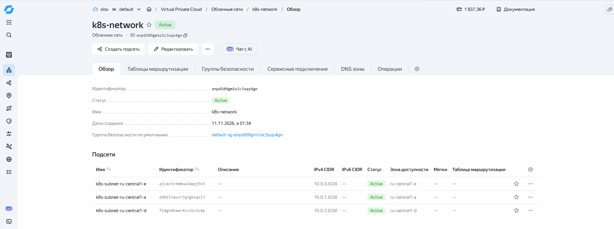


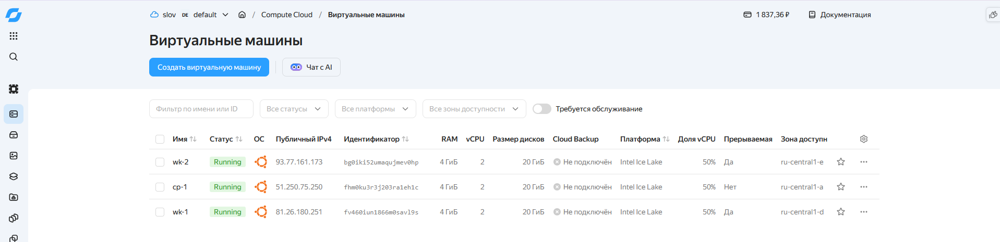


**3.** Убеждаемся, что теперь команды terraform destroy и terraform apply выполняются без дополнительных ручных действий.

```
terraform destroy && terraform apply
```


Инфраструктура удалена и создана заново без дополнительных ручных действий.  

---
### Создание Kubernetes кластера

На этом этапе необходимо создать [Kubernetes](https://kubernetes.io/ru/docs/concepts/overview/what-is-kubernetes/) кластер на базе предварительно созданной инфраструктуры.   Требуется обеспечить доступ к ресурсам из Интернета.

Это можно сделать двумя способами:

1. Рекомендуемый вариант: самостоятельная установка Kubernetes кластера.  
   а. При помощи Terraform подготовить как минимум 3 виртуальных машины Compute Cloud для создания Kubernetes-кластера. Тип виртуальной машины следует выбрать самостоятельно с учётом требовании к производительности и стоимости. Если в дальнейшем поймете, что необходимо сменить тип инстанса, используйте Terraform для внесения изменений.  
   б. Подготовить [ansible](https://www.ansible.com/) конфигурации, можно воспользоваться, например [Kubespray](https://kubernetes.io/docs/setup/production-environment/tools/kubespray/)  
   в. Задеплоить Kubernetes на подготовленные ранее инстансы, в случае нехватки каких-либо ресурсов вы всегда можете создать их при помощи Terraform.
2. Альтернативный вариант: воспользуйтесь сервисом [Yandex Managed Service for Kubernetes](https://cloud.yandex.ru/services/managed-kubernetes)  
  а. С помощью terraform resource для [kubernetes](https://registry.terraform.io/providers/yandex-cloud/yandex/latest/docs/resources/kubernetes_cluster) создать **региональный** мастер kubernetes с размещением нод в разных 3 подсетях      
  б. С помощью terraform resource для [kubernetes node group](https://registry.terraform.io/providers/yandex-cloud/yandex/latest/docs/resources/kubernetes_node_group)
  
Ожидаемый результат:

1. Работоспособный Kubernetes кластер.
2. В файле `~/.kube/config` находятся данные для доступа к кластеру.
3. Команда `kubectl get pods --all-namespaces` отрабатывает без ошибок.

---

### Решение. Создание Kubernetes кластера  

**1.** При создании инфраструктуры при помощи `Terraform` были созданы ВМ в разных подсетях и зонах доступности для создания кластера Kubernetes ("cp-1" - `control-plane` (master), "wk-1" и "wk-2" - воркеры).  
Ansible-инвентарь для установки Kubernetes кластера был сгенерирован автоматически `Terraform`.  


**2.** Создаём ansible конфигурацию для установки Kubernetes кластера.

- Оновной плейбук - [**playbook.yml**](https://github.com/SLOV1977/devops-diplom-yandexcloud/tree/main/ansible/playbook.yml)
- Подготовка всех нод:
  - Предварительная подготовка `prereq` - [**main.yml**](https://github.com/SLOV1977/devops-diplom-yandexcloud/tree/main/ansible/prereq/tasks/main.yml)  
  - Установка `containerd` - [**main.yml**](https://github.com/SLOV1977/devops-diplom-yandexcloud/tree/main/ansible/containerd/tasks/main.yml)  
  - Установка `kubeadm` - [**main.yml**](https://github.com/SLOV1977/devops-diplom-yandexcloud/tree/main/ansible/kubeadm/tasks/main.yml)  
- Инициализация `control-plane` - [**main.yml**](https://github.com/SLOV1977/devops-diplom-yandexcloud/tree/main/ansible/control-plane/tasks/main.yml)  
- Подключение worker-нод - [**main.yml**](https://github.com/SLOV1977/devops-diplom-yandexcloud/tree/main/ansible/join-workers/tasks/main.yml)  
- Настройка локального kubeconfig - [**main.yml**](https://github.com/SLOV1977/devops-diplom-yandexcloud/tree/main/ansible/join-workers/tasks/main.yml)  

**3.** Установка Kubernetes через ansible.  

Плейбук последовательно прогоняет роли: `prereq` (`sysctl`, `swap`, модули ядра) → `containerd` → `kubeadm` на всех нодах, затем инициализирует `control-plane`, подключает воркеров и забирает `kubeconfig`.

```
cd ../../ansible
ansible-playbook -i inventory/hosts.yaml playbook.yml -v
```
**4.** Настраиваем kubeconfig и проверяем кластер

```
mkdir -p ~/.kube
cp inventory/artifacts/admin.conf ~/.kube/diplom.conf
chmod 600 ~/.kube/diplom.conf
export KUBECONFIG=~/.kube/diplom.conf
echo 'export KUBECONFIG=~/.kube/diplom.conf' >> ~/.bashrc
source ~/.bashrc
kubectl get nodes
kubectl get pods --all-namespaces
```


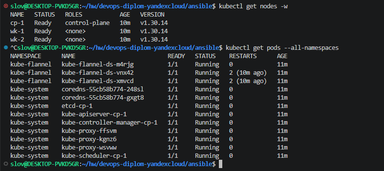

Кластер успешно создан.

---
### Создание тестового приложения

Для перехода к следующему этапу необходимо подготовить тестовое приложение, эмулирующее основное приложение разрабатываемое вашей компанией.

Способ подготовки:

1. Рекомендуемый вариант:  
   а. Создайте отдельный git репозиторий с простым nginx конфигом, который будет отдавать статические данные.  
   б. Подготовьте Dockerfile для создания образа приложения.  
2. Альтернативный вариант:  
   а. Используйте любой другой код, главное, чтобы был самостоятельно создан Dockerfile.

Ожидаемый результат:

1. Git репозиторий с тестовым приложением и Dockerfile.
2. Регистри с собранным docker image. В качестве регистри может быть DockerHub или [Yandex Container Registry](https://cloud.yandex.ru/services/container-registry), созданный также с помощью terraform.

---
### Решение. Создание тестового приложения

**1.** Создаем отдельный [репозиторий](https://github.com/SLOV1977/devops-diplom-app) для тестового приложения.  
**2.** Клонируем его себе в локальное расположение и переходим в него:
```
cd ../..
git clone https://github.com/SLOV1977/devops-diplom-app.git
cd devops-diplom-app
```

**3.** Создаем статичную web-страницу:  

```
<!DOCTYPE html>
<html lang="ru">
<head>
    <meta charset="UTF-8">
    <meta name="viewport" content="width=device-width, initial-scale=1.0">
    <title>Дипломный проект DevOps</title>
    <link rel="stylesheet" href="styles.css">
</head>
<body>
    <div class="container">
        <header>
            <h1>🎓 Дипломный практикум в Yandex.Cloud</h1>
            <p>Выполнил: Рахманов Александр</p>
        </header>
        
        <main>
            <section class="status">
                <h2>Статус системы</h2>
                <div class="status-cards">
                    <div class="card online">
                        <h3>Приложение</h3>
                        <p>🟢 Онлайн</p>
                    </div>
                    <div class="card online">
                        <h3>Кластер Kubernetes</h3>
                        <p>🟢 Работает</p>
                    </div>
                    <div class="card online">
                        <h3>Мониторинг</h3>
                        <p>🟢 Активен</p>
                    </div>
                </div>
            </section>
            
            <section class="components">
                <h2>Компоненты системы</h2>
                <ul>
                    <li>✅ Yandex Cloud Infrastructure</li>
                    <li>✅ Kubernetes Cluster</li>
                    <li>✅ Docker Registry</li>
                    <li>✅ Prometheus + Grafana</li>
                    <li>✅ CI/CD Pipeline</li>
                </ul>
            </section>
        </main>
        
        <footer>
            <p>Время сервера: <span id="server-time"></span></p>
            <p>Версия: 1.0.0</p>
        </footer>
    </div>
    
    <script src="app.js"></script>
</body>
</html>
```
**4.** Подготавливаем `Dockerfile` для создания образа приложения:  

```
FROM nginx:1.27-alpine

COPY nginx.conf /etc/nginx/conf.d/default.conf
COPY index.html /usr/share/nginx/html/index.html

EXPOSE 80

HEALTHCHECK --interval=30s --timeout=3s CMD wget -q -O - http://localhost/ || exit 1
```
**5.** Создаём образ приложения:  

```
docker build -t slov1977/devops-diplom-app:v1.0.0 .
```


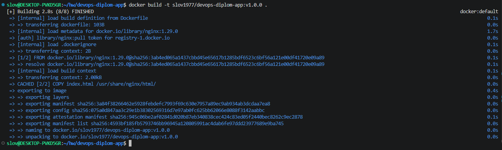

**5.** Проверяем созданный образ:  

```
docker images
```


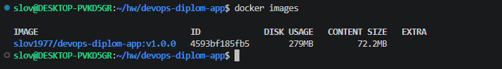

**6.** Публикуем образ в Docker Hub:  

```
docker push slov1977/devops-diplom-app:v1.0.0
```


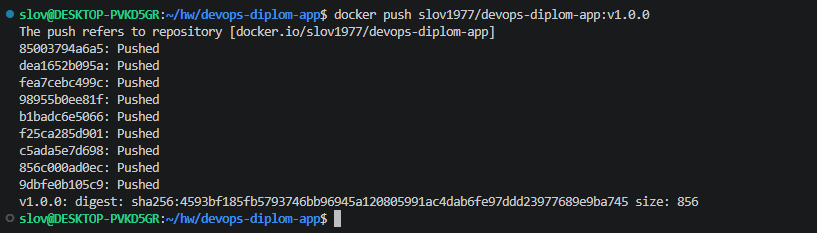

Образ приложения размещён в Docker Hub.


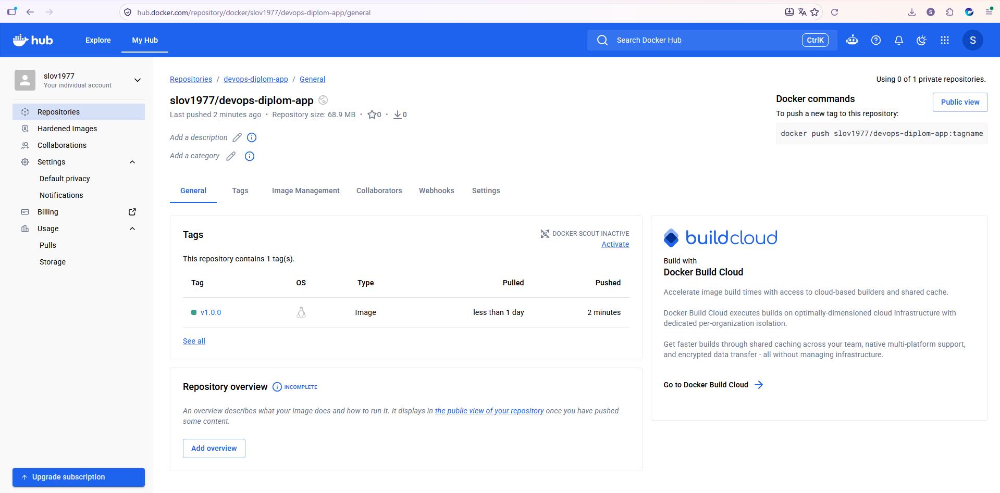

---
### Подготовка cистемы мониторинга и деплой приложения

Уже должны быть готовы конфигурации для автоматического создания облачной инфраструктуры и поднятия Kubernetes кластера.  
Теперь необходимо подготовить конфигурационные файлы для настройки нашего Kubernetes кластера.

Цель:
1. Задеплоить в кластер [prometheus](https://prometheus.io/), [grafana](https://grafana.com/), [alertmanager](https://github.com/prometheus/alertmanager), [экспортер](https://github.com/prometheus/node_exporter) основных метрик Kubernetes.
2. Задеплоить тестовое приложение, например, [nginx](https://www.nginx.com/) сервер отдающий статическую страницу.

Способ выполнения:
1. Воспользоваться пакетом [kube-prometheus](https://github.com/prometheus-operator/kube-prometheus), который уже включает в себя [Kubernetes оператор](https://operatorhub.io/) для [grafana](https://grafana.com/), [prometheus](https://prometheus.io/), [alertmanager](https://github.com/prometheus/alertmanager) и [node_exporter](https://github.com/prometheus/node_exporter). Альтернативный вариант - использовать набор helm чартов от [bitnami](https://github.com/bitnami/charts/tree/main/bitnami).

---
### Решение. Подготовка cистемы мониторинга и деплой приложения

**1.** local-path-provisioner — чтобы у Prometheus, Grafana и Alertmanager были PVC:  

```
cd ../devops-diplom-yandexcloud/ansible
kubectl apply -f https://raw.githubusercontent.com/rancher/local-path-provisioner/master/deploy/local-path-storage.yaml
```

**2.** ingress-nginx (DaemonSet, NodePort 30080):  

```
helm repo add ingress-nginx https://kubernetes.github.io/ingress-nginx --force-update
helm upgrade --install ingress-nginx ingress-nginx/ingress-nginx \
  -n ingress-nginx --create-namespace \
  -f k8s-config/ingress-nginx/values.yaml
```

Ждём под контроллера:  

```
kubectl -n ingress-nginx get pods -w
```


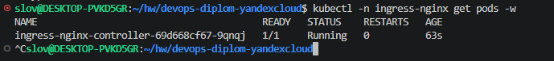


**3.** Установка `kube-prometheus-stack`. Шаблон values содержит ${GRAFANA_EXTERNAL_IP}, который надо подставить вручную:  

[**kps-values.yaml.template**](https://github.com/SLOV1977/devops-diplom-yandexcloud/tree/main/k8s-config/monitoring/kps-values.yaml.template)  

```
cd ..
export INGRESS_IP=$(terraform -chdir=terraform/main output -raw ingress_external_ip)
echo $INGRESS_IP
sed "s|\${GRAFANA_EXTERNAL_IP}|${INGRESS_IP}|g" \
  k8s-config/monitoring/kps-values.yaml.template > k8s-config/monitoring/kps-values.yaml
sed 's/${GRAFANA_EXTERNAL_IP}/84.201.174.104/g' kps-values.yaml.template > kps-values.yaml
helm repo add prometheus-community https://prometheus-community.github.io/helm-charts --force-update
helm upgrade --install kps prometheus-community/kube-prometheus-stack \
  -n monitoring --create-namespace -f /tmp/kps-values.yaml
```

**4.** Установка `Ingress Grafana`:  

[**grafana-ingress.yaml**](https://github.com/SLOV1977/devops-diplom-yandexcloud/tree/main/k8s-config/monitoring/grafana-ingress.yaml)  

```
kubectl apply -f k8s-config/monitoring/grafana-ingress.yaml
```

Дождитесь, когда все поды в `monitoring` и `ingress-nginx` станут `Running`:  

```
kubectl get pods -A -w
```


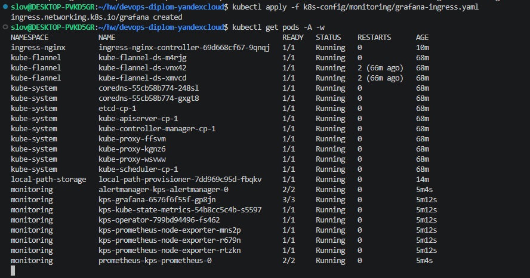

**7.** Проверяем web-интерфейс Grafana и проходим авторизацию с заранее заданным в grafana-values.yaml паролем. Проверяем состояние кластера:  


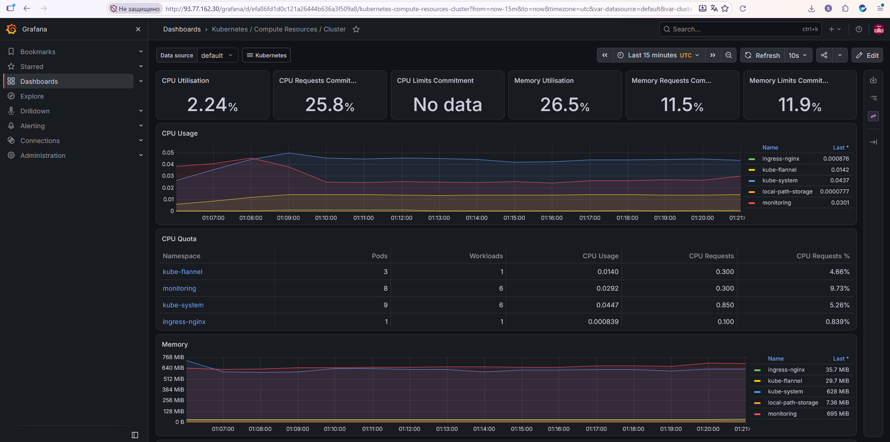

**8.** Установка приложения.  

[**manifests.yaml**](https://github.com/SLOV1977/devops-diplom-yandexcloud/tree/main/k8s-config/app/manifests.yaml)  

Подставляем свой логин Docker Hub и тег вместо заглушки APP_IMAGE:  

```
export DOCKERHUB_USER="slov1977"          # ваш логин
APP_IMAGE="$DOCKERHUB_USER/devops-diplom-app:v1.0.0"
sed "s|APP_IMAGE|${APP_IMAGE}|g" k8s-config/app/manifests.yaml | kubectl apply -f -
```

Ждём деплой и проверяем:  

```
kubectl -n app rollout status deployment/devops-diplom-app
kubectl -n app get pods -o wide
```


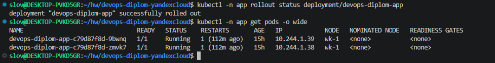


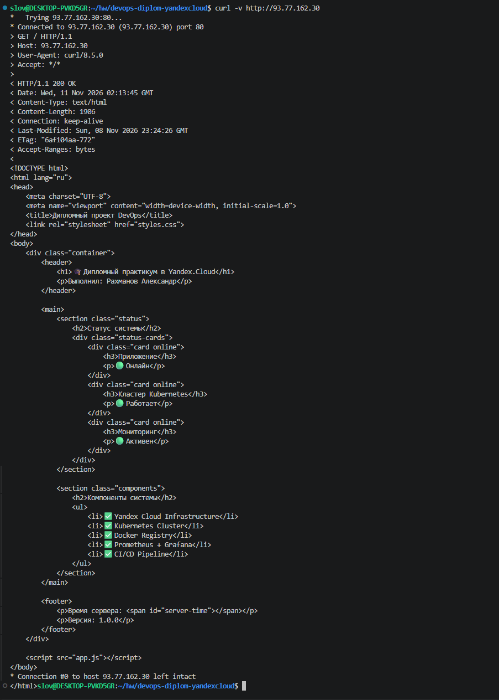


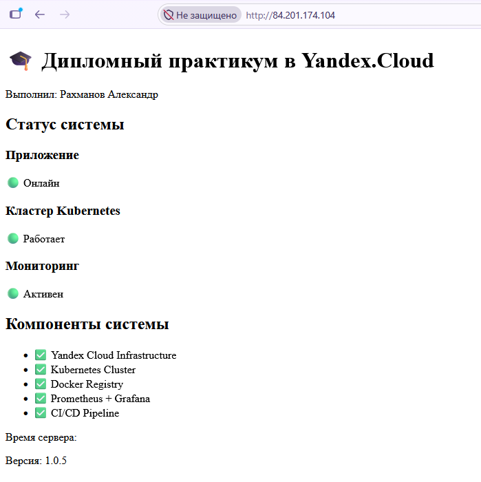

Для распределения нагрузки и обеспечения отказоустойчивости добавляем балансировщик нагрузки и таргет-групп в файл terraform/main/main.tf:  

```
resource "yandex_lb_network_load_balancer" "ingress" {
  name      = "k8s-ingress-nlb"
  region_id = "ru-central1"
  type      = "external"

  listener {
    name        = "http"
    port        = 80
    target_port = 30080          # NodePort ingress-nginx

    external_address_spec {
      address = yandex_vpc_address.ingress.external_ipv4_address[0].address
    }
  }

  attached_target_group {
    target_group_id = yandex_lb_target_group.ingress.id

    healthcheck {
      name                = "http-health"
      interval            = 10
      timeout             = 5
      healthy_threshold   = 2
      unhealthy_threshold = 3

      http_options {
        port = 30080
        path = "/healthz"
      }
    }
  }
}
```

И применяем изменения:  

```
cd terraform/main
terraform init
terraform apply
```

---
### Деплой инфраструктуры в terraform pipeline

1. Если на первом этапе вы не воспользовались [Terraform Cloud](https://app.terraform.io/), то задеплойте и настройте в кластере [atlantis](https://www.runatlantis.io/) для отслеживания изменений инфраструктуры. Альтернативный вариант 3 задания: вместо Terraform Cloud или atlantis настройте на автоматический запуск и применение конфигурации terraform из вашего git-репозитория в выбранной вами CI-CD системе при любом комите в main ветку. Предоставьте скриншоты работы пайплайна из CI/CD системы.

Ожидаемый результат:
1. Git репозиторий с конфигурационными файлами для настройки Kubernetes.
2. Http доступ на 80 порту к web интерфейсу grafana.
3. Дашборды в grafana отображающие состояние Kubernetes кластера.
4. Http доступ на 80 порту к тестовому приложению.
5. Atlantis или terraform cloud или ci/cd-terraform  

---
### Решение. Деплой инфраструктуры в terraform pipeline  

Настраиваем автоматическое развертывание инфраструктуры terraform через Github Action.  

- Cоздаем директорию .github/workflows/ и в ней файл [**terraform.yml**](https://github.com/SLOV1977/devops-diplom-yandexcloud/tree/main/.github/workflows/terraform.yml)  

- Добавляем секретные данные, которые будут передаваться при исполнении манифестов


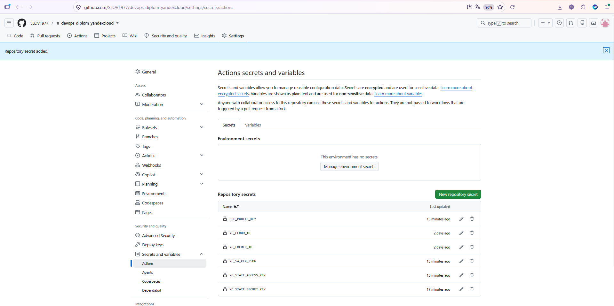

- Манифест выполняется при ручном запуске, а также при `git push` кода `Terraform` в `main` ветку репозитория, после внесения в него изменений.  

- Результат выполнения манифеста.


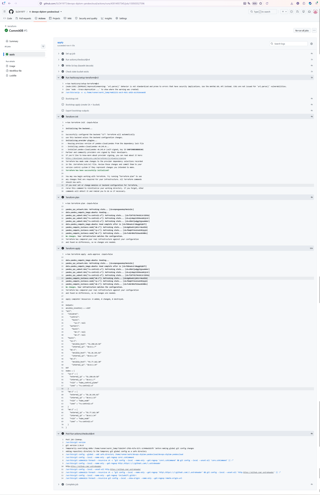

---
### Установка и настройка CI/CD

Осталось настроить ci/cd систему для автоматической сборки docker image и деплоя приложения при изменении кода.

Цель:

1. Автоматическая сборка docker образа при коммите в репозиторий с тестовым приложением.
2. Автоматический деплой нового docker образа.

Можно использовать [teamcity](https://www.jetbrains.com/ru-ru/teamcity/), [jenkins](https://www.jenkins.io/), [GitLab CI](https://about.gitlab.com/stages-devops-lifecycle/continuous-integration/) или GitHub Actions.

Ожидаемый результат:

1. Интерфейс ci/cd сервиса доступен по http.
2. При любом коммите в репозиторие с тестовым приложением происходит сборка и отправка в регистр Docker образа.
3. При создании тега (например, v1.0.0) происходит сборка и отправка с соответствующим label в регистри, а также деплой соответствующего Docker образа в кластер Kubernetes.

---
### Решение. Установка и настройка CI/CD  

Настраиваем ci/cd систему для автоматической сборки docker image и деплоя приложения при изменении кода с помощью GitHub Actions.  

- Для этого в [репозитории](https://github.com/SLOV1977/devops-diplom-app) приложения создаем файл `.github/workflows/ci-cd.yml`.  

- Добавляем в `GitHub Action` данные для `DockerHub` и `Kubernetes`-кластера.  


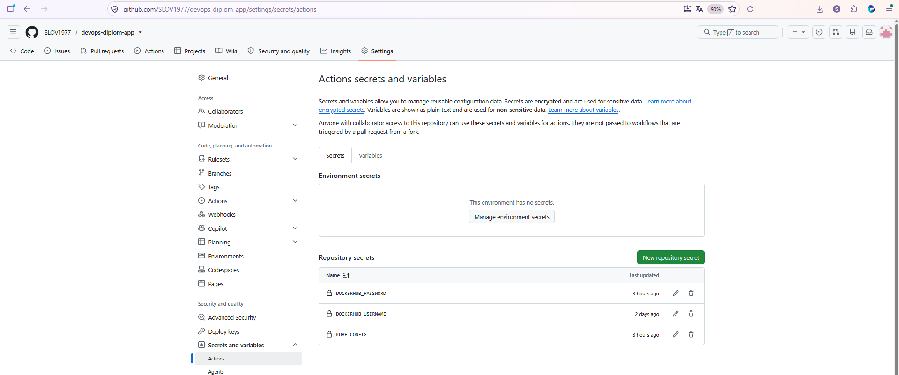

- Редактируем `index.html` и пишем в коммите комментарий `release v1.0.3` и отправляем в ветку `main` в `Github`:


- Проверяем образы на `DockerHub`. Новый образ с новым `tag` добавился в `DockerHub`:  


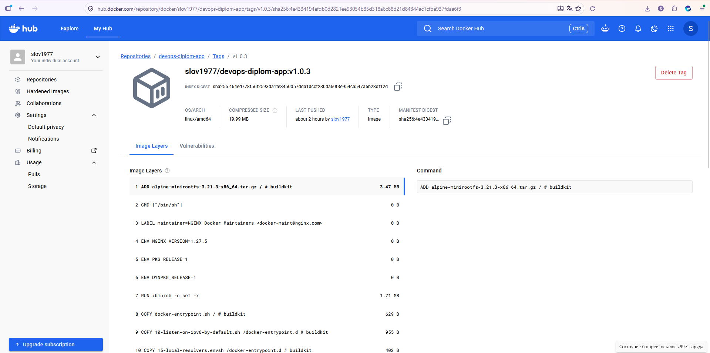

- Web-страница приложения обновилась.


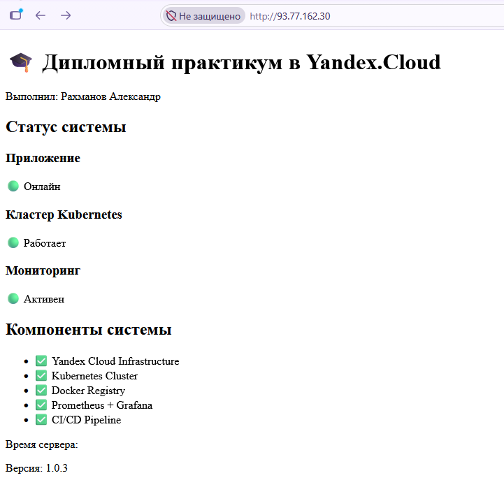

Автоматическая сборка docker-image с новым тегом и деплой приложения в кластер прошли успешно.  

---
## Что необходимо для сдачи задания?

1. Репозиторий с конфигурационными файлами Terraform и готовность продемонстрировать создание всех ресурсов с нуля.
2. Пример pull request с комментариями созданными atlantis'ом или снимки экрана из Terraform Cloud или вашего CI-CD-terraform pipeline.
3. Репозиторий с конфигурацией ansible, если был выбран способ создания Kubernetes кластера при помощи ansible.
4. Репозиторий с Dockerfile тестового приложения и ссылка на собранный docker image.
5. Репозиторий с конфигурацией Kubernetes кластера.
6. Ссылка на тестовое приложение и веб интерфейс Grafana с данными доступа.
7. Все репозитории рекомендуется хранить на одном ресурсе (github, gitlab)

---

## Решение. Что необходимо для сдачи задания?  

[**Репозиторий приложения**](https://github.com/SLOV1977/devops-diplom-app)  
[**Репозиторий дипломной работы**](https://github.com/SLOV1977/devops-diplom-yandexcloud)  
[**Docker image в DockerHub**](https://hub.docker.com/repository/docker/slov1977/devops-diplom-app/general)  
[**Тестовое приложение**](http://84.201.174.104/)  
[**Веб интерфейс Grafana**](http://84.201.174.104/grafana) (admin:diplom-admin)  

---